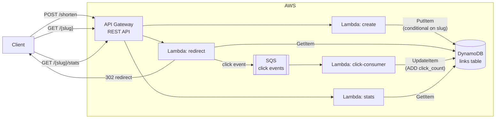

# Architecture

The redirect path and the click-count increment are deliberately separate: the redirect Lambda only reads and responds, the counter update happens asynchronously via the consumer Lambda off the SQS queue. See [`../docs/design-decisions.md`](../docs/design-decisions.md).
